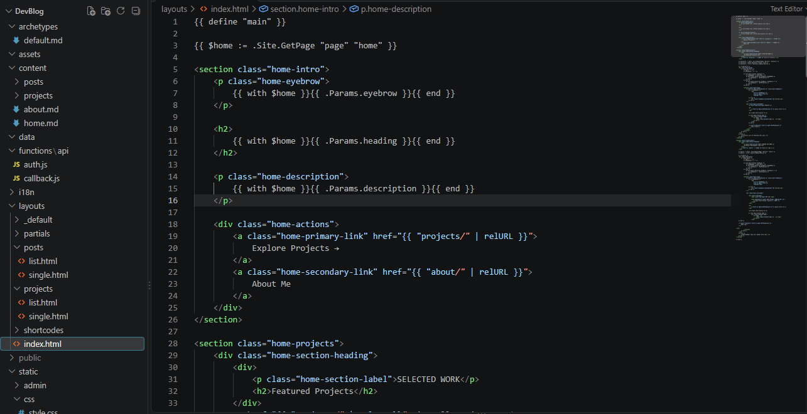
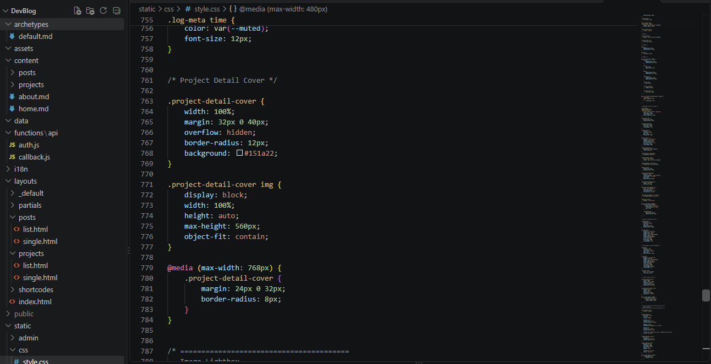
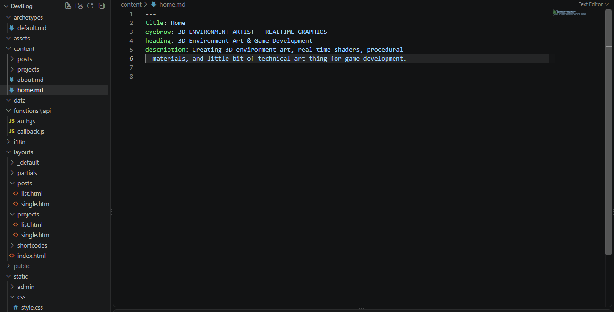
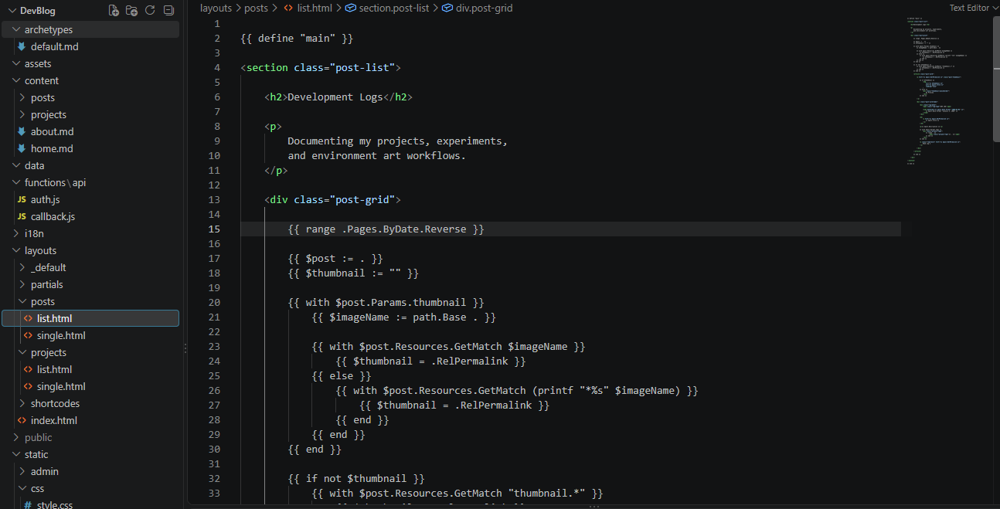
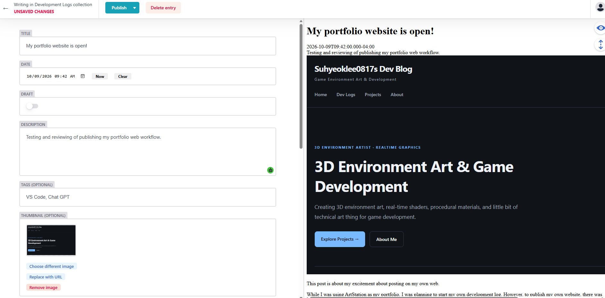

This post is about my excitement about posting on my own web.

While I was using ArtStation as my portfolio, I was planning to start my own development log. However, to publish my own website, there was too much difficulty in designing a website, such as coding JavaScript, publishing a domain, etc. 

But in this year, ChatGPT gave me the guideline on how to create my own website, so I could create my own Dev Blog with my portfolio!

Thanks to artificial intelligence, I could code JavaScript and other programming languages just by copying and pasting the codes. 

There were some errors when it runs, but I asked the AI to review and repair the code several times. Of course it took time, but eventually I could successfully manage to create the website without error.

There was a freezing error while using administration mode. This error took almost 2 hours, but I found that the problem was from some spelling errors in the code. But that made me happy that I finally found the issue and solved it.

So.. that's it! Welcome to my dev blog! I will post my development log mainly on this website and 3D environment projects (or maybe game projects?). 

I will be working on ArtStation as well, but only for portfolio because I cannot post my small devlogs on ArtStation.
