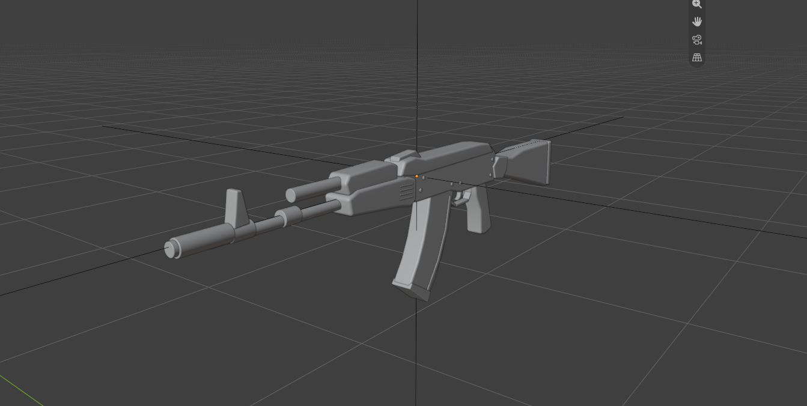
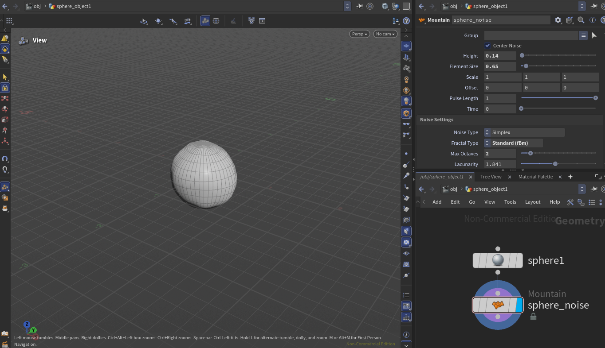
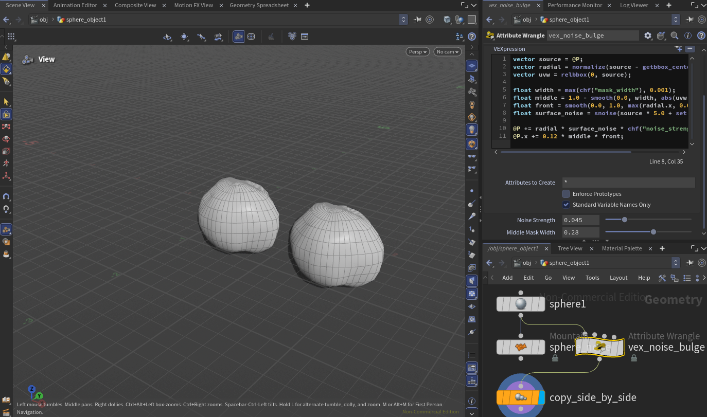
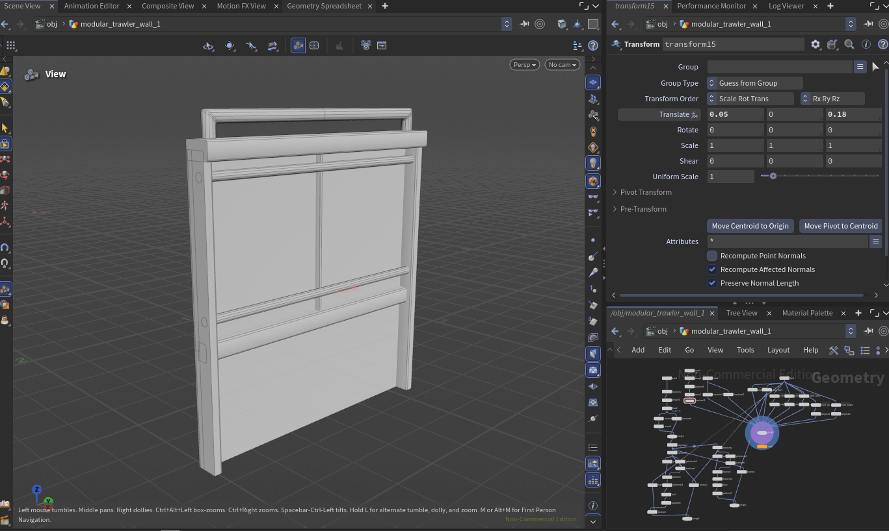
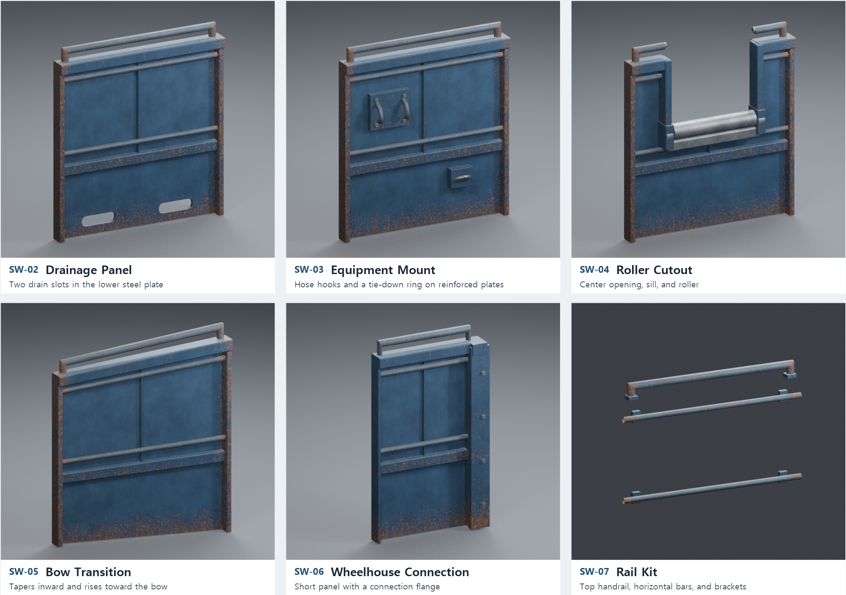
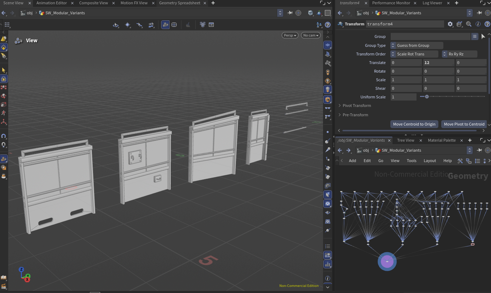
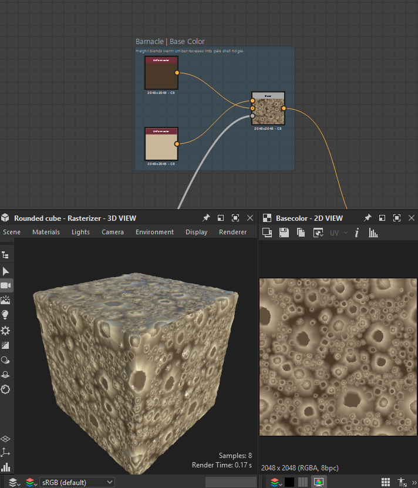
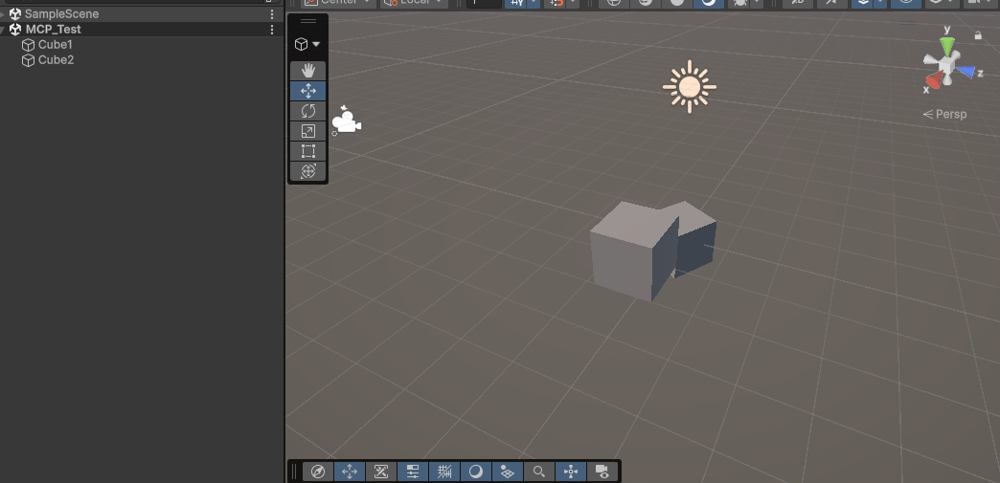
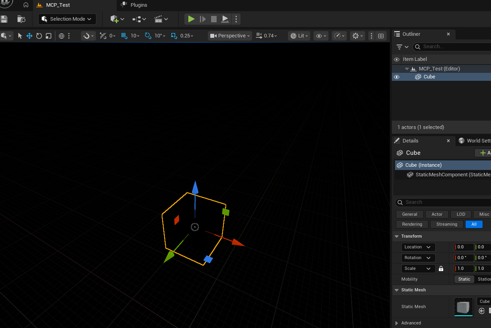
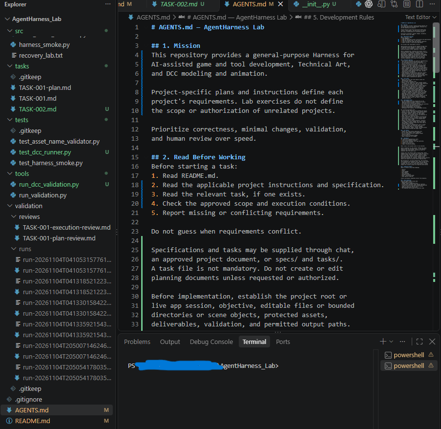

**Blender**

I gave Codex some AK74M images and asked to model AK74M in Blender. The quality is not that good, but I can use this model for a mockup of the prop at least. Detailing needs human hands, but I expect that it can dramatically reduce the initial process time of modeling.

**Houdini**

Firstly, I asked Codex to create a sphere and put a noise in the geometry node.

It can also create the node with a VEX code.  

I modeled a testing modular wall, and I gave Codex this screenshot and asked, "Create 4 variant concepts of this modular wall." 

And this is the result.

**Substance Designer**

**Unity Engine**

**Unreal Engine 5**

And I finished setting up each MCP for the rest of them.

Now I am working on setting up the harness! But I think it will need time to get used to using it.
